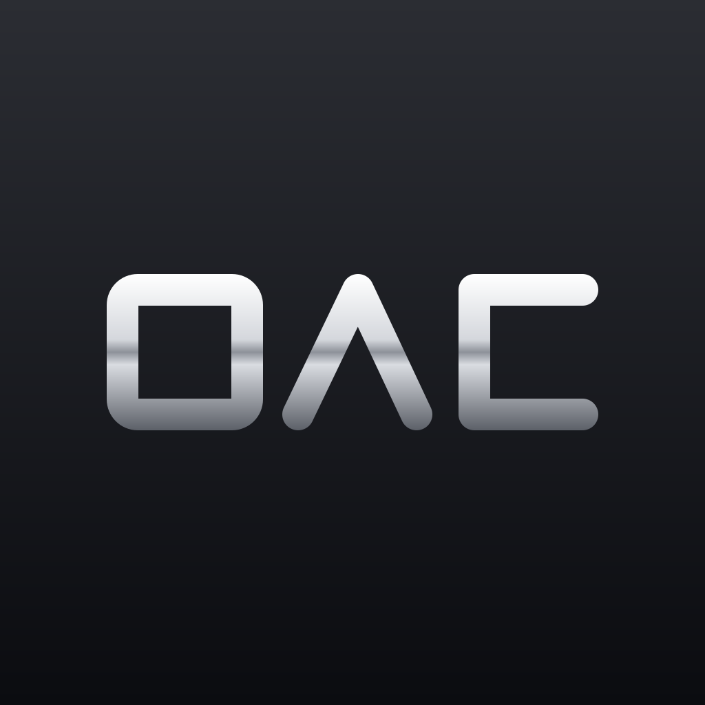

<p align="center"></p>

# 모시다

주야간보호센터 어르신 등하원 차량용 Pleos Connect 앱.
좌석을 배치하고, 차 화면과 음성으로 다음 하차 어르신을 안내하고, 뒷문이 열릴 때마다 하차를 확인해 기록을 남깁니다. 빈 좌석을 사람이 확인하기 전에는 운행을 끝낼 수 없습니다.

## APK

- 위치: [`apk/플랜에이징_모시다_release.apk`](apk/) (release, 서명됨)
- 패키지: `ai.planaging.mosida`

## 센터 사무실 화면 (등하원표 자동 생성)

`center-web/index.html`을 브라우저로 열면 바로 돌아갑니다. 서버와 설치가 필요 없고, 입력 내용은 PC 밖으로 나가지 않습니다.

1. 날짜와 등원·하원을 고릅니다.
2. 어르신을 차량 / 보호자 직접 / 결석으로 표시하고, 오늘 근무자를 고릅니다.
3. "등하원표 만들기" → 차량·운전자·동승자, 1·2차, 내리는 순서, 자리, 배정 이유가 나옵니다. 끌어서 옮기거나 버튼으로 고칠 수 있습니다.
4. 표를 엑셀용으로 저장하거나 차로 보낼 파일(mosida-trip.json)을 저장합니다.
5. 시연에서는 저장한 파일을 차 앱으로 보냅니다(실제 운행은 서버에서 받는 구조로 바뀝니다). 앱의 "센터 표에서 내 운행 고르기"에 차별 운행이 나옵니다.
   ```powershell
   $b64 = [Convert]::ToBase64String([IO.File]::ReadAllBytes("mosida-trip.json"))
   adb shell "am start -n ai.planaging.mosida/.MainActivity --es trip_b64 '$b64'"
   ```

스타리아 1열에는 운전자와 동승 직원만 앉습니다(어르신 8명). 2차에 한 분만 남으면 자리 있는 다른 차로 옮깁니다.

화면의 데이터는 시연용으로 지어낸 것입니다(`node tools/make-sample-data.js`). `node center-web/verify.js`로 표와 기록을 비교할 수 있습니다.

## 등원(승차) 흐름

센터 화면에서 등원표를 만들어 보내면 차 앱이 등원 운행으로 돕니다. 어르신별 탑승 예정 시각은 센터 도착 목표(08:30·09:00) 기준이고, 기록에는 실제 시각만 남습니다.

1. 집 앞에서 뒷문이 열리면 자리를 안내하고 "타셨나요?"를 묻습니다. 탑승 확인을 눌러야 기록됩니다.
2. 안 나오시면 "아직 안 나오셨어요 / 보호자 전화 / 오늘 안 오심" 중에서 사람이 고릅니다. 화면에 예정보다 몇 분 밀렸는지 보입니다.
3. 모두 태우면 센터로 갑니다. 도착해서 뒷문을 열면 "모두 내리셨나요?"를 한 번 묻고, 좌석 센서를 확인한 뒤 운행이 끝납니다.
4. 같은 차의 다음 회차가 있으면 기록 화면에서 이어서 시작합니다.

## 기록과 내보내기

- 운행이 끝나면 엑셀(CSV)이 운행마다 따로 저장됩니다. 모든 줄에 날짜·운행·차량·운전·동승이 들어가고, 출발·도착 주행거리와 어르신 차량 체류 시간 요약이 붙습니다.
- 하루의 등원·하원을 어르신별 한 줄로 합친 기관 전산 형식 파일(`기관전산_날짜.csv`)도 저장됩니다. 주간보호의 그날 제공시간은 등원 탑승 시각부터 하원 하차 시각까지이며, 앱은 기록된 두 시각의 차이를 계산만 합니다(시각을 고치는 기능은 없습니다).
- 진행 중인 운행은 앱이 꺼져도 이어집니다.

## 테스트 환경

- Pleos Connect Emulator v2.1.0 (Android Automotive, API 34), RAM 6GB 권장 (`-memory 6144`. 4GB면 내비가 경로 계산 중 강제 종료될 수 있습니다)
- Android SDK API 34, minSdk 28, JDK 17~21
- Pleos SDK: Vehicle 2.3.2 · TextToSpeech 3.3.1 · NaviHelper 3.0.5
- Pleos 키 값은 필요 없습니다 (음성은 ON_DEVICE 모드, 차량·내비 신호는 에뮬레이터에서 바로 받음)

## 실행 방법

1. Pleos Connect 에뮬레이터를 켭니다.
2. APK를 설치합니다. Pleos 차량·음성·내비 권한은 설치할 때 함께 부여됩니다.
   ```
   adb install -r -g "apk/플랜에이징_모시다_release.apk"
   ```
3. **(권장) 내비 화면 위로 앱이 돌아오도록 허용합니다.** 경로가 바뀔 때마다 Pleos 내비가 지도를 앞으로 띄우는데, 이 허용이 있으면 2~3초 뒤와 뒷문이 열릴 때 모시다가 다시 앞으로 옵니다. 허용이 없으면 하단 런처의 모시다 아이콘을 직접 누르면 됩니다.
   ```
   adb shell appops set --user 10 ai.planaging.mosida SYSTEM_ALERT_WINDOW allow
   ```
4. 하단 런처에서 **모시다**를 엽니다.
5. 차량 신호는 Virtual Console로 조작합니다: `adb forward tcp:8088 tcp:8088` 후 브라우저에서 `http://127.0.0.1:8088` (뒷문 = 2열 오른쪽 문, 기어 P/D).

## 시연 순서 (3분)

1. 한 명을 "결석" → "하차 순서대로 자동 배치". 그러면 **하차의 역순(마지막에 내릴 분부터)**으로 한 분씩 탑승을 부릅니다. 배정된 자리에 앉으시면(좌석 센서, 센서 없는 자리는 "탑승 확인" 버튼) 이름을 불러 인사하고 다음 분을 부릅니다.
2. "배치 완료 · 운행 시작" — Pleos 내비에 다음 두 집 + 마지막 집 경로가 들어갑니다. 출발(D)하면 다음 집 보호자께 내비 도착 예정 시간으로 알림을 보냅니다(시연: 실제 발송 없이 기록만).
3. 기어 D에서 뒷문 열기 → 빨간 경고 + 음성 "주행 중 뒷문이 열렸습니다".
4. 기어 P에서 뒷문 열기 → 🔊 "김 어르신 댁에 도착했습니다" + "하차하셨나요?" → "하차 확인" → 보호자께 "잘 들어가셨습니다" 알림. 보호자가 안 나와 계시면 "📞 보호자 전화"(시연: 실제 발신 없음). 음성이 다음 어르신을 번호와 성으로 안내합니다("다음 하차, 2번 서 어르신…").
5. 전원 하차 후 "운행 종료" → 좌석 센서에 사람이 감지되면 종료가 잠깁니다 → 직접 확인 후 종료.
6. 운행 기록 → "엑셀로 내보내기"(CSV).

자세한 안내: [docs/demo1/DEMO-GUIDE.md](docs/demo1/DEMO-GUIDE.md)

## 에뮬레이터 참고

- 에뮬레이터 지도 데이터가 판교·성남 일대뿐이라, 시연 좌표는 판교 근처의 가짜 좌표입니다. 화면의 동네 이름은 지어낸 것입니다.
- Pleos 내비는 서버의 9091번 포트를 씁니다. 이 포트를 막는 네트워크에서는 내비가 준비 상태가 되지 않아 경로가 들어가지 않습니다(앱의 나머지 기능은 동작). 그럴 때는 다른 네트워크를 쓰고 내비를 다시 시작해 주세요.
- Vehicle SDK 2.3.2의 착석 값은 차량 표준·에뮬레이터 콘솔과 반대로 나와서 앱에서 뒤집어 씁니다(`PleosVehicleGateway.sdkOccupancyInverted`).
- 에뮬레이터 차량은 2열 모델이라 3·4열 좌석 센서 값이 없습니다. 앱은 해당 좌석을 "모름"으로 두고 기록으로 판단합니다.

## 시연 데이터

모든 어르신·직원·동네·기록은 시연용으로 지어낸 것입니다. 실존 인물이나 기관의 정보는 저장소에 없습니다.
